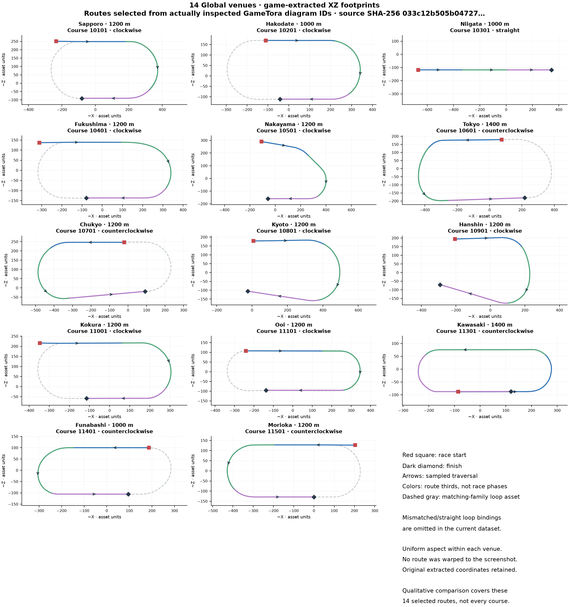

# Fourteen Global venues: extracted route crosscheck

Reviewed October 14, 2026. All fourteen GameTora venue pages were opened and the
first displayed course diagram from each was checked. The exact
page, diagram URL and screenshot path are recorded locally in
`research/geometry/gametora-checked-pages.json`.
Every saved diagram was visually inspected and compared with its corresponding
game-extracted route in [the fourteen-venue plot](assets/global-game-geometry-14.png).
This review covers those selected routes and Tokyo turf 2,400 m separately;
it does **not** validate every distance/variant, every event boundary, or
Longchamp's external-reference agreement.

The plot reads `research/geometry/course-geometry.json`, with 119 course bindings
and 140 path/loop assets in the final reviewed export, with 82 loop bindings.
Its SHA-256 is
`033c12b505b0472794ca85bea22bdb7f7e4326b2381edda0daf5b95eeaa7643b`.
Measurements and asset selections in the local
`research/geometry/global-geometry-validation.json` retain the extraction
provenance. [The script](../scripts/plot-global-geometry.py)
uses original XZ coordinates, a common 180-degree rotation (`−X, −Z`) and equal
aspect within each panel. It does not fit, warp or trace screenshot pixels.
Colored route thirds are visual aids, not game race phases. Gray dashes show a
**separate** loop asset and must not be confused with the selected race route.

## Per-venue comparison

All fourteen selected **race routes** qualitatively match their references in
direction, major curve/straight footprint and start/finish ordering. “Match” here
is bounded visual agreement, not a metric calibration or a numeric error claim.

| GameTora reference | Selected course | Observed agreement / caveat |
| --- | --- | --- |
| [Sapporo](https://gametora.com/%75%6D%61%6D%75%73%75%6D%65/racetracks/sapporo) | 10101 · turf 1,200 m | Clockwise right-hand U; upper start before long right bend, lower finish farther left. |
| [Hakodate](https://gametora.com/%75%6D%61%6D%75%73%75%6D%65/racetracks/hakodate) | 10201 · turf 1,000 m | Clockwise compact right-hand U; short bottom finish stretch. |
| [Niigata](https://gametora.com/%75%6D%61%6D%75%73%75%6D%65/racetracks/niigata) | 10301 · turf 1,000 m | Straight traversal left to right; venue oval deliberately omitted from this comparison. |
| [Fukushima](https://gametora.com/%75%6D%61%6D%75%73%75%6D%65/racetracks/fukushima) | 10401 · turf 1,200 m | Clockwise right-hand U; upper and lower stretches almost parallel. |
| [Nakayama](https://gametora.com/%75%6D%61%6D%75%73%75%6D%65/racetracks/nakayama) | 10501 · outer turf 1,200 m | Sloping upper chute and compound right bend agree. Mismatched generic inner-loop binding removed. |
| [Tokyo](https://gametora.com/%75%6D%61%6D%75%73%75%6D%65/racetracks/tokyo) | 10601 · turf 1,400 m | Counterclockwise left-hand U; asymmetric left transitions and tilted lower straight agree. |
| [Chukyo](https://gametora.com/%75%6D%61%6D%75%73%75%6D%65/racetracks/chukyo) | 10701 · turf 1,200 m | Counterclockwise left-hand U; lower straight slopes upward toward its right-side finish. |
| [Kyoto](https://gametora.com/%75%6D%61%6D%75%73%75%6D%65/racetracks/kyoto) | 10801 · inner turf 1,200 m | Clockwise right bend and tilted lower finish stretch agree; mismatched generic-loop binding removed. |
| [Hanshin](https://gametora.com/%75%6D%61%6D%75%73%75%6D%65/racetracks/hanshin) | 10901 · inner turf 1,200 m | Clockwise broad right bend, noticeably diagonal lower finish stretch agree; mismatched generic-loop binding removed. |
| [Kokura](https://gametora.com/%75%6D%61%6D%75%73%75%6D%65/racetracks/kokura) | 11001 · turf 1,200 m | Clockwise compact right-hand U; long upper start stretch. |
| [Ooi](https://gametora.com/%75%6D%61%6D%75%73%75%6D%65/racetracks/ooi) | 11101 · dirt 1,200 m | Clockwise short-radius right-hand U and straight lower finish stretch agree. |
| [Kawasaki](https://gametora.com/%75%6D%61%6D%75%73%75%6D%65/racetracks/kawasaki) | 11301 · dirt 1,400 m | Counterclockwise compact oval traversal; distinct lower-home start left of finish. |
| [Funabashi](https://gametora.com/%75%6D%61%6D%75%73%75%6D%65/racetracks/funabashi) | 11401 · dirt 1,000 m | Counterclockwise left-hand U; straight upper/lower legs with finish nearer the middle. |
| [Morioka](https://gametora.com/%75%6D%61%6D%75%73%75%6D%65/racetracks/morioka) | 11501 · dirt 1,200 m | Counterclockwise left-hand U; extended upper start and lower finish leg agree. |

## Differences that must remain explicit

GameTora's selected short-distance illustrations usually show only the traveled
U-shaped route, not a whole closed circuit. The plot's gray loop can include
untraveled parts; that is additional asset evidence, not a discrepancy in the
highlighted race route. The preliminary export assigned Nakayama's `00_2_0`
outer route to a visibly different generic `00_0_0` loop, and Kyoto/Hanshin's
`00_1_0` inner routes also inherited unverified generic loops. **That issue is
fixed in the final export:** 37 straight/partial or mismatched-variant courses
have no loop binding; their original selected race paths remain available.
Missing variant-specific loops stay missing. They are not replaced by
constructed ovals or assumed to match merely because the venue/surface matches.

Tokyo's independent [2,400 m analysis](tokyo-geometry-validation.md) also shows
that its nominal 2,095-unit closed loop and its 2,400 race curve have different
parameterizations and slightly different footprints. Use the actual selected
race curve for runner positions; modulo-distance positioning on an unrelated
loop would introduce error. Geometry suffixes do not prove constant lane
offsets. Screenshot agreement validates neither the lane-to-metres conversion
nor numeric outer-lane distance loss.

No GameTora images were bundled into runtime data. The reference screenshots
remain investigation artifacts. Original local game coordinates, source
identity and uncertainty should remain attached to any promoted geometry.
