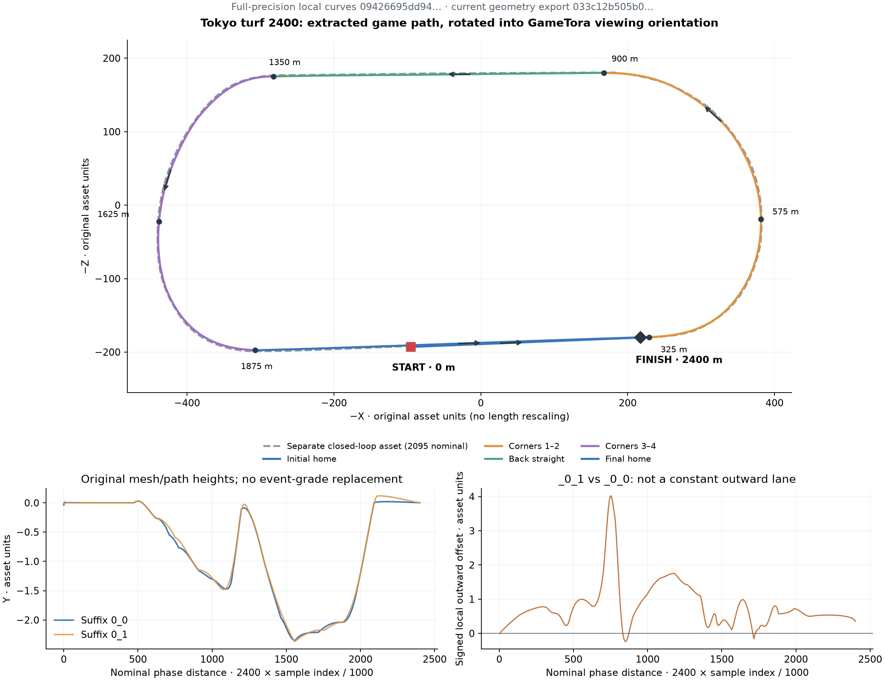

# Tokyo turf 2,400 m: geometry crosscheck and acceptance criteria

Reviewed October 14, 2026. Target: Global game course `10606`, track `10006`,
surface turf, left/counterclockwise. This note validates an independently
extracted game route. The earlier fixed-radius diagram was a schematic and is
not used as coordinate evidence. The viewer now uses the extracted path.

## Reference evidence

| Evidence | What it establishes | What it does not establish |
| --- | --- | --- |
| [GameTora Tokyo page](https://gametora.com/%75%6D%61%6D%75%73%75%6D%65/racetracks/tokyo), Global `2400 m · Turf`, inspected in the live UI earlier in this session | Course ID, segment ranges/grades, qualitative map and start/finish ordering | Surveyed coordinates, radii, engine metres or lane-to-metres conversion |
| Local `artifacts/gametora-tokyo-2400.png` | The actual rendered all-laps diagram used for the visual comparison | Pixel distances as physical distances |
| [JRA Tokyo course guide](https://www.jra.go.jp/facilities/race/tokyo/course/index.html) | Official physical venue dimensions, direction and rail variants | The game's centreline, simulation lane widths or asset scale |
| [JRA Derby course description](https://jra.jp/keiba/g1/derby.html) | Physical 2,400 m start is midway along the stand straight, around the top of the uphill | Exact game start transform |
| [JRA English Tokyo details](https://japanracing.jp/en/racing/go_racing/jra_racecourses/course_details/tokyo.html) | Independent official English venue context | Game geometry |

The live Global page was checked again on October 14, 2026. The saved screenshot,
`artifacts/gametora-tokyo-2400-current.png`, was compared with the extracted
curve below. The official JRA course guide provided a separate physical-venue
reference. No external image was copied into the application runtime.

## What the game reference should match

In the saved map, the lower home straight runs to the right. The red start flag
is around its middle, before the checkered finish farther right. Both lie on
the same stretch. After starting, the route turns around the right end, follows
the upper back stretch to the left, turns around the left end and returns to
the lower straight. The footprint appears asymmetric, with compound transitions
at the left end and a more rounded right end; it is not two identical
semicircles joined by rigorously parallel straight lines. These are visual
observations, not measured curve parameters. Do not digitize that screenshot
and present the result as game-extracted coordinates.

The GameTora Global table matches the pinned Moomoolator reference snapshot
`5ce95905fef753a33f7519b5559a86e92f5d56cc` on these course distances:

| Region | Start–end, race metres |
| --- | --- |
| Initial straight | 0–325 |
| Corner 1 / Corner 2 | 325–575 / 575–900 |
| Back straight | 900–1,350 |
| Corner 3 / Corner 4 | 1,350–1,625 / 1,625–1,875 |
| Final straight | 1,875–2,400 |
| Uphill | 0–40 (+1.5%), 1,125–1,200 (+2%), 1,950–2,100 (+1.5%) |
| Downhill | 1,250–1,500 (−1.5%) |
| Early / middle / late / final sixth | 0–400 / 400–1,600 / 1,600–2,000 / 2,000–2,400 |

The image's “spurt starts” reference at 1,600 m is a race-phase boundary; it is
not an individual runner's observed spurt start. Preserve the recorded runner
field separately.

## Physical venue dimensions are a crosscheck

JRA identifies a left-handed turf course with a 525.9 m final straight and
2.7 m total elevation difference. A-course circumference is 2,083.1 m and width
31–41 m. Its B/C/D variants measure 2,101.9 / 2,120.8 / 2,139.6 m, with widths
28–38 / 25–35 / 22–32 m. JRA's [2026 rail-variant notice](https://www.jra.go.jp/keiba/baba/overview/2026_2-3_tokyo.html)
places their inner rails 3 / 6 / 9 m outside A. The 2,400 m physical race thus
exceeds one A-course lap by 316.9 m, explaining distinct home-straight start and
finish positions. This is an arithmetic consequence of the physical dimensions,
not proof of the game's lap length or its chosen reference rail.

The game reference's 525 m final stretch closely matches the official 525.9 m.
Its event-grade integration, however, produces a **derived** height range of
3.75 m (from −1.65 to +2.10 m relative to the start), rather than JRA's 2.7 m.
Keep gameplay slope events, visual mesh elevation and physical venue elevation
separate; do not force one to equal the others.

## Acceptance criteria for extracted assets

1. Retain the local asset/member identity, hash, game version and course mapping.
   Recover a race path/spline and its parameterization where available; a fence,
   camera spline or mesh silhouette alone is insufficient.
2. Establish axes, handedness and units from asset data or documented transforms.
   Preserve original coordinates. A viewport rotation/scale is only a display
   transform, never a length calibration from screenshot pixels.
3. Render the recovered closed circuit, the `10606` race start transform and
   finish crossing. Qualitatively compare direction, asymmetry and start/finish
   placement with GameTora. A 2,400 m traversal must pass all four corner ranges
   in order and finish after its initial home-straight position, without a chord,
   jump, fabricated radius or arbitrary “80% of straight” finish inset.
4. Compare asset arc lengths and designated event points with the table above.
   Record discrepancies, rounding and tolerance explicitly. Do not stretch each
   segment independently until it happens to match. Compare with JRA only as a
   separate physical-venue sanity check, allowing game/rail differences.
5. Before reporting **outer-lane distance loss**, establish what recorded lane
   values mean, their metric conversion, the reference rail/centreline, path
   curvature and runner longitudinal coordinate. Current `lane / 10000` is a
   dimensionless parser normalization; current diagram lane pixels are unrelated
   to metres. JRA's track width does not resolve that conversion.

For a verified planar route with constant outward offset `y` and turn angle
`Δθ`, the geometric excess on a convex bend is `y × Δθ`; a complete simple
convex lap gives `2πy`. With changing offset, lateral travel contributes as well:
the path-length element contains both the curvature term and `dy/ds`. Banking,
3D elevation, lane-change interpolation and the game's distance/speed semantics
need their own evidence. Even verified geometric excess is not automatically
lost race time or a causal skill penalty. Until those mappings are established,
the viewer may show the actual extracted shape but must leave quantified
outer-lane loss unavailable.

## Independent check of the extracted game curves

The provided extraction `research/geometry/course-lane-curves.json` contains
1,001 XYZ/quaternion samples per curve. This review recalculated the lengths
from those arrays, independently of `course-lane-summary.json`; it did not
access the live game or the shared REA session. The input SHA-256 is
`09426695dd9436d2e8dcd8e9aa03fbe33cb833de812ce19dfece4fbe99309570`.
[Plot](assets/tokyo-game-xz-validation.png), local machine-readable measurements
in `research/geometry/tokyo-curve-validation.json` and the
[reproduction script](../scripts/plot-tokyo-geometry.py) are saved.
The current promoted geometry export has 119 course bindings, 140 paths and
82 loop bindings, SHA-256
`033c12b505b0472794ca85bea22bdb7f7e4326b2381edda0daf5b95eeaa7643b`.
The plot preserves the original full-precision diagnostic curves; the report
also checks their base coordinates against the current export's three-decimal
serialization. Diagnostic suffix variants below are not automatically promoted
as alternate lanes.

| Asset suffix after `an_pos_race10006_` | Nominal distance | Sampled XZ arc length | Sampled 3D arc length | End gap |
| --- | ---: | ---: | ---: | ---: |
| `00_2400_00_0_0` | 2,400 | 2,400.006 | 2,400.041 | 312.837 |
| `00_2400_00_0_1` | 2,400 | 2,404.675 | 2,404.709 | 312.823 |
| `01_0000_00_0_0` | 2,095 | 2,095.046 | 2,095.082 | 0 |
| `01_0000_00_0_1` | 2,095 | 2,094.995 | 2,095.032 | 0 |

Lengths are in original asset units. Base 2,400-curve XZ step lengths are
2.399414–2.400668, averaging 2.400006. That independently supports the near
identity between its original spatial units and nominal course metres; no
arbitrary scale factor was applied. Nominal progress in the plot is
`2400 × sample index / 1000`, with interpolation between samples. This relation
is especially well supported for the uniform base curve; it is not a proof of
how the engine evaluates every variant at runtime.

Use `horizontal = -X, vertical = -Z` in ordinary Cartesian plotting. This is
a 180-degree planar rotation, not an asymmetric fit or reflection. For SVG's
downward-positive screen Y, the equivalent display is `x = -X, y = +Z` followed
only by a uniform viewport scale/translation. Raw XZ signed loop area is
positive (counterclockwise), and this orientation preserves the left-handed
route visible in GameTora.

The 2,400 base starts at `(95.264, -0.038, 193.040)` and finishes at
`(-217.306, 0.000, 180.100)`. After that display rotation, start is left of
finish on the gently tilted lower home straight. The corners/straights marked
at the reference distances fall in the expected locations: 325 at the lower
right entry, 575 near the rightmost end, 900 at the upper right, 1,350 at the
upper left, 1,625 near the leftmost end and 1,875 at the lower left exit. The
fresh GameTora screenshot qualitatively agrees with the asymmetric footprint,
counterclockwise movement and start/finish order. It has not been numerically
registered to pixels, so this is a qualitative crosscheck rather than a
claim of pixel-perfect equality.

Finite-difference tangent rotation across the four reference corner intervals
is approximately 88.55 / 88.54 / 83.59 / 93.77 degrees. These differ from the
old schematic's forced 90-degree arcs. Applying the standard Unity quaternion
formula to the base curve, local `+Z` agrees with its forward XZ tangent and
local `+X` with its outward XZ normal: both dot products have minimum 0.99823
and median 0.999979. This strongly corroborates the orientation convention.
It does not establish the simulation's numeric lane-to-world-unit conversion.

**Keep race traversal and the separate closed-loop asset distinct.** The base
race passes nearest its finish location early at XZ arc distance 312.838
(projection residual 0.081), leaving 2,087.168 to its final finish. The separate
loop measures 2,095.046 and has slightly different bounds. Mapping recorded race
distance modulo 2,095 onto that other asset would therefore introduce a phase
error. Use the actual 2,400 curve for runner positions and compare the separate
loop only as an outline unless their engine relationship is established.

Suffix `_0_1` is **not** demonstrated to be a constant outward lane. Its race
arc is 4.669 units longer, but locally projecting it onto nearby base segments
gives signed outward differences from −0.238 to +4.023 (median +0.613), along
with phase shifts. Its closed-loop version is actually 0.051 units shorter
than the `_0_0` loop. The suffix's meaning must remain unresolved until metadata
or engine code identifies it. The smaller `_01_0_0` family has a 1,909-unit
closed loop and a different 2,400 start; it must not be treated as an outer
lane of the turf family based solely on the file name.

Base sampled Y range is 2.375 units, versus the event-grade-derived 3.75 m and
JRA physical 2.7 m. Those remain separate representations. This review validates
the extracted Tokyo footprint and coordinate orientation; it does not yet
validate numeric outer-lane distance loss or all other racetracks.
